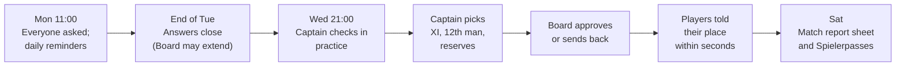
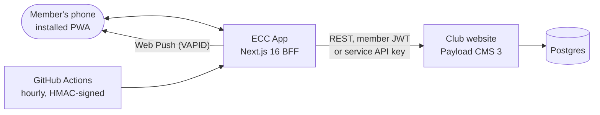

# ECC App

[](https://github.com/Saqibrafiq/ecc-app/actions/workflows/ci.yml)


**The members' app of Erlangen Cricket Club**: an installable web app on every member's phone that runs the club's match week, from "are you in?" on Monday to the signed match report after Saturday's game.

It replaces a Facebook event per match and head-counting by hand. Members answer from a notification, practices are created automatically, captains record attendance and pick the squad from eligible players, the Board approves it, and every player learns within seconds whether they were selected. The club's rules, written in its motions, are encoded as a pure, fully tested domain module, so the app decides eligibility the same way every time.

Built and maintained by [Saqib Rafiq](https://github.com/Saqibrafiq) as a production system for a real club, running at **€0** on free tiers.

## Highlights

- **Club rules as a pure domain module.** Practice days, the 2-of-4 attendance rule, deadlines, carry-overs, eligibility and availability targets are framework-free TypeScript with **100% branch coverage**, tested across daylight-saving changes ([ADR-0005](docs/arc42/09-architecture-decisions/0005-club-rules-as-pure-domain-module.md)).
- **An idempotent notification pipeline.** One planner decides what is due; every notification is claimed under a deterministic key before it is sent, so a doubled or late trigger never double-sends. An hourly HMAC-signed tick from GitHub Actions catches up on anything missed, and a change (a squad handed in, approved, a practice recorded) runs the same tick at once with `after()` ([ADR-0004](docs/arc42/09-architecture-decisions/0004-hourly-idempotent-jobs-from-github-actions.md)).
- **Web Push without an app store.** VAPID push to iPhone and Android, each device in the language it registered in; a shared phone follows whoever is signed in ([ADR-0001](docs/arc42/09-architecture-decisions/0001-installable-web-app-instead-of-native.md), [ADR-0003](docs/arc42/09-architecture-decisions/0003-web-push-with-vapid.md)).
- **Backend-for-frontend over a headless CMS.** The club website's Payload CMS is the single system of record; every member request runs with the member's own token, so access rules hold in the database, not only in the UI ([ADR-0002](docs/arc42/09-architecture-decisions/0002-website-cms-as-system-of-record.md)).
- **Official paperwork, generated.** The squad is filled into the cricket federation's DCB match report sheet as a PDF, with each player's registered name and pass number ([ADR-0007](docs/arc42/09-architecture-decisions/0007-fill-the-official-dcb-match-report-sheet.md)).
- **Architecture that is enforced, not just drawn.** Vertical feature slices with a public `index.ts` each; dependency-cruiser fails the build on a layer or boundary violation.
- **Accessible by default.** WCAG 2.2 AA target; every end-to-end test scans with axe on iPhone (WebKit) and Android (Chromium) profiles; motion respects "reduce motion".
- **Documented like a product.** arc42 architecture documentation with C4 diagrams in Mermaid, quality scenarios, a risk and debt register, and seven ADRs.

## What it does

| For              | What they get                                                                                                                                                                                                                                       |
| ---------------- | --------------------------------------------------------------------------------------------------------------------------------------------------------------------------------------------------------------------------------------------------- |
| **Players**      | The week's match and practice, one-tap Going / Not going (with a reason), daily reminders until answered, their attendance standing and what they still need, availability targets, the season schedule with results, and the announced team sheet. |
| **Captains**     | A check-in prompt on practice evening with walk-ins, squad selection with eligibility and the reason at a glance, and match day: the filled match report sheet, every Spielerpass, no-shows and the signed sheet's upload.                          |
| **The Board**    | The week's squads by urgency: approve and announce, or send back with a note; extend a deadline; make a one-match exception. Notified the moment a squad is handed in.                                                                              |
| **Every member** | English and German throughout, a notification setting per device, and a profile with the language switch.                                                                                                                                           |

### A match week



### Club rules, encoded and tested

| Rule                                                                                      | Source             |
| ----------------------------------------------------------------------------------------- | ------------------ |
| A Saturday match means practice on Wednesday; a Sunday match, on Thursday.                | Club practice      |
| At least **2 of the team's last 4 practices** to be selectable, with a running countdown. | Motion 2023/01     |
| The 12th man and reserves carry over to the team's next match.                            | Motion 2023/10     |
| A selected player who does not appear sits out the next match.                            | Motion 2023/10 (2) |
| Only players flagged ECC I eligible play for ECC I; the Board can make exceptions.        | Motion 2024/06     |
| Availability targets: 50 % of away matches, 80 % of the season for captains.              | Motions 2023/05-06 |

The full set, with every decision the club took on edge cases, is in [arc42 §1](docs/arc42/01-introduction-and-goals.md).

## Architecture



```
src/
  app/            Routes only: compose features, no business logic
  features/       Vertical slices (week, team, board, match-day, season, squad, jobs, ...)
    <feature>/
      components/ Server Components by default; client only where interactive
      domain/     Pure feature logic
      server/     Data access, server actions, queries
      index.ts    The only file other modules may import
  domain/
    club-rules/   The club's rules: pure TypeScript, 100% branch coverage
  shared/         Design system, utilities, Zod-validated configuration
```

| Decision                                         | Why                                                                                    |
| ------------------------------------------------ | -------------------------------------------------------------------------------------- |
| Installable web app instead of native            | One codebase, no store fees or review, push on iPhone and Android, €0.                 |
| The website's CMS as system of record            | Fixtures, players and accounts live in one place; no data is entered twice.            |
| Hourly signed tick instead of fixed cron entries | Correct local times across DST, deadlines that move, self-healing after a missed run.  |
| Club rules as a pure module                      | The rules decide who plays; they must be readable, reviewable and exhaustively tested. |
| Personal invite links shared by the Board        | No email service to run; members join from a WhatsApp message.                         |

All decisions, with the options considered and their consequences: [ADRs](docs/arc42/09-architecture-decisions/README.md).

## Engineering practice

| Concern        | How it is handled                                                                                                                                             |
| -------------- | ------------------------------------------------------------------------------------------------------------------------------------------------------------- |
| Correctness    | TypeScript `strict` with `noUncheckedIndexedAccess`; every external input (forms, env, backend responses, URLs) parsed with Zod.                              |
| Testing        | 600+ unit and component tests (Vitest, Testing Library); Playwright end-to-end with axe on two device profiles; 100% on the domain rules.                     |
| Architecture   | dependency-cruiser enforces layers and feature boundaries in CI.                                                                                              |
| Reliability    | Claim-before-send notification log; a doubled tick sends nothing twice, a missed one catches up (quality scenarios QS-5, QS-6).                               |
| Security       | HTTP-only session cookie, signed job endpoint with a five-minute replay window, CSP for the service worker, secrets only in env.                              |
| Privacy (GDPR) | No tracking cookies; notifications name events and counts, never who said what; a reason for absence is seen only by the member, their captain and the Board. |
| Delivery       | Trunk-based with short-lived branches, Conventional Commits, generated changelog, Husky and lint-staged hooks.                                                |

**CI on every pull request:** format, lint, types, architecture rules, unit tests with coverage, a production build with the Playwright and accessibility suite, and a Storybook build.

## Tech stack

| Area          | Choice                                                                          |
| ------------- | ------------------------------------------------------------------------------- |
| Framework     | Next.js 16 (App Router, Server Components, Server Actions), React 19            |
| Language      | TypeScript (strict)                                                             |
| UI            | Tailwind CSS v4 with design tokens, Radix primitives, Motion, lucide icons      |
| Data          | Payload CMS 3 on Postgres (the club website), Zod at every boundary             |
| i18n          | next-intl (English, German)                                                     |
| Notifications | Web Push (VAPID), GitHub Actions scheduler                                      |
| Documents     | pdf-lib (the DCB match report sheet)                                            |
| Quality       | Vitest, Testing Library, Playwright, axe, Storybook, ESLint, dependency-cruiser |

## Getting started

Requires Node.js 24 and pnpm (`corepack enable`).

```bash
pnpm install
pnpm dev            # http://localhost:3000 (German: /de)
```

Without a backend the app runs as a **preview with sample data**, so every screen can be explored straight away. For real data, run the [club website](https://github.com/Saqibrafiq/erlangen-cricket-club) locally (`pnpm dev --port 3001`) and set `BACKEND_URL` and `BACKEND_SERVICE_API_KEY` in `.env.local`; see [`.env.example`](.env.example) for push keys and the job secret.

| Command                        | What it does                                                |
| ------------------------------ | ----------------------------------------------------------- |
| `pnpm lint` / `pnpm typecheck` | ESLint (type-checked, jsx-a11y) and TypeScript              |
| `pnpm depcruise`               | Architecture rules: layers, feature boundaries, pure domain |
| `pnpm test` / `test:coverage`  | Unit and component tests                                    |
| `pnpm test:e2e`                | Playwright on iPhone and Android profiles, with axe         |
| `pnpm storybook`               | Component workshop                                          |
| `pnpm jobs:tick`               | Fire one signed scheduler tick against the local app        |
| `pnpm changelog`               | Regenerate `CHANGELOG.md` from the Conventional Commits     |

## Status

Feature-complete for the season: the player's week and attendance, captains' check-in, selection and match day, the Board's review, the season schedule, the announced team sheet, and push notifications for every step. **Next:** production launch, then personal invite links for onboarding members ([ADR-0006](docs/arc42/09-architecture-decisions/0006-personal-invite-links-shared-by-the-admin.md)).

Known limitations are tracked openly in the [risk and debt register](docs/arc42/11-risks-and-technical-debt.md), for example: the service worker does not cache yet, so reading the week needs a connection.

## Documentation

- [arc42 architecture documentation](docs/arc42/README.md): goals, constraints, context, solution strategy, building blocks, runtime scenarios, deployment, cross-cutting concepts, decisions, quality scenarios, risks and a cricket glossary (English and German).
- [Architecture decision records](docs/arc42/09-architecture-decisions/README.md)
- The [club website](https://github.com/Saqibrafiq/erlangen-cricket-club), this app's backend.

## Licence

Proprietary, published for viewing only. See [LICENSE](LICENSE).
