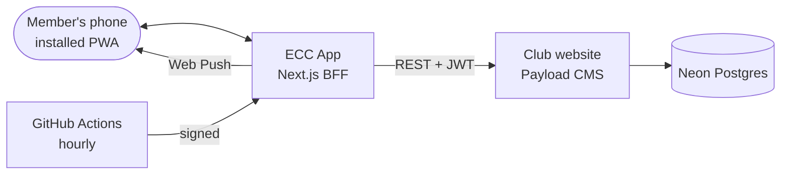

# ECC App

Squad availability and practice attendance for **Erlangen Cricket Club**: an installable web app (PWA) on every member's phone that replaces Facebook events.

Members answer **Going / Not going** from a notification. Practices are created automatically. Captains mark attendance at the ground and pick the squad from eligible players. The board approves it, and the captain gets the squad's Spielerpasses for the umpire.

> **Status:** sign-in with the club account; the player's week and attendance ledger on real data, with correction requests and availability targets; the captain's check-in and squad selection; the Board's review, deadlines and exceptions, and admins standing in for an absent captain. Without a backend the app shows a preview with sample data. Next: the profile page.

## What it does

| For          | Features                                                                                                                                                       |
| ------------ | -------------------------------------------------------------------------------------------------------------------------------------------------------------- |
| **Players**  | The week's match and practice for their team (and the other team's), one-tap answers with a reason for "not going", their attendance and what they still need. |
| **Captains** | 21:00 practice check-in with walk-ins; squad selection with eligibility at a glance; Spielerpasses of the approved squad.                                      |
| **Admins**   | Squad approval, deadline extensions, exceptions, members, roles, teams and the ECC I flag.                                                                     |

### Club rules, encoded and tested

- Saturday match → practice on Wednesday; Sunday match → practice on Thursday.
- At least **2 of the team's last 4 practices** to be selectable, with a countdown ("attend 2 of the next 3").
- Availability closes at the end of Tuesday unless an admin extends it.
- ECC I selection only for players flagged as ECC I eligible; admins can make exceptions.

## Architecture at a glance

- **PWA** (Next.js 16, React 19, TypeScript strict): installable on iPhone and Android, Web Push, offline reading. €0, no app store ([ADR-0001](docs/arc42/09-architecture-decisions/0001-installable-web-app-instead-of-native.md)).
- **Backend-for-frontend** on top of the [club website's](https://github.com/Saqibrafiq/erlangen-cricket-club) Payload CMS, the single system of record for fixtures, players and accounts ([ADR-0002](docs/arc42/09-architecture-decisions/0002-website-cms-as-system-of-record.md)).
- **Club rules as a pure domain module**, 100% branch-covered and tested across daylight-saving changes ([ADR-0005](docs/arc42/09-architecture-decisions/0005-club-rules-as-pure-domain-module.md)).
- **Hourly, idempotent jobs** from GitHub Actions for reminders and deadlines: DST-safe, never double-send ([ADR-0004](docs/arc42/09-architecture-decisions/0004-hourly-idempotent-jobs-from-github-actions.md)).



## Getting started

Requires Node.js 24 and pnpm (`corepack enable`).

```bash
pnpm install
pnpm dev            # http://localhost:3000 (German: /de)
```

Without a backend the app runs as a **preview with sample data**. To work with real data, run the [club website](https://github.com/Saqibrafiq/erlangen-cricket-club) locally on another port (`pnpm dev --port 3001`) and set `BACKEND_URL`, `BACKEND_SERVICE_API_KEY` (an admin account with an API key) and optionally `APP_NOW` in `.env.local` (see `.env.example`).

| Command                        | What it does                                                      |
| ------------------------------ | ----------------------------------------------------------------- |
| `pnpm lint` / `pnpm typecheck` | ESLint (strict, type-checked, jsx-a11y) and TypeScript            |
| `pnpm depcruise`               | Architecture rules: layers, feature boundaries, pure domain       |
| `pnpm test` / `test:coverage`  | Unit and component tests (Vitest, Testing Library)                |
| `pnpm test:e2e`                | Playwright on iPhone and Android profiles, with axe accessibility |
| `pnpm storybook`               | Component workshop                                                |
| `pnpm changelog`               | Regenerate `CHANGELOG.md` from the Conventional Commits           |

Every pull request runs all of the above in CI, plus SonarCloud once its token is set.

## Documentation

[arc42](docs/arc42/README.md): goals, constraints, context, solution strategy, building blocks and domain model, runtime, deployment, cross-cutting concepts, decisions, quality scenarios, risks and glossary.

## Licence

Proprietary, published for viewing only. See [LICENSE](LICENSE).
