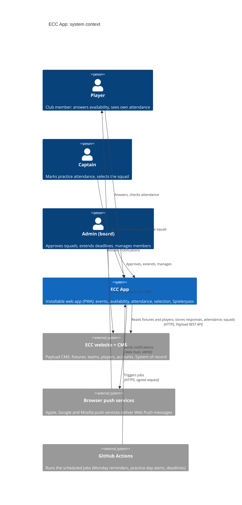

# 3. Context & Scope

## 3.1 Business context

| Neighbour                 | Exchanged                                                                                                                        |
| ------------------------- | -------------------------------------------------------------------------------------------------------------------------------- |
| **Players**               | In: Going / Not going (+ reason). Out: events, notifications, own attendance and eligibility.                                    |
| **Captains**              | In: practice attendance, walk-ins, squad selection. Out: who is going, eligibility per player, Spielerpasses of approved squads. |
| **Admins**                | In: approvals, deadline extensions, exceptions, member data. Out: overview of all teams and events.                              |
| **ECC website + CMS**     | Fixtures (date, time, ground, opponent, team), teams, players, user accounts and roles. All app data is stored here too.         |
| **Browser push services** | Encrypted push messages to each subscribed device. They see only an opaque payload.                                              |
| **GitHub Actions**        | An hourly signed request; the app decides what is due (ADR-0004).                                                                |

## 3.2 Technical context

| Channel                      | Technology                                                       | Notes                                                                                    |
| ---------------------------- | ---------------------------------------------------------------- | ---------------------------------------------------------------------------------------- |
| Member's phone ↔ app         | HTTPS; installed PWA (manifest + service worker)                 | Session in an HTTP-only, same-site cookie on the app's own domain.                       |
| App server ↔ website backend | HTTPS, Payload REST API, JSON; JWT in the `Authorization` header | Server-to-server only; the browser never calls the CMS (backend-for-frontend, ADR-0002). |
| App server → push services   | Web Push protocol, VAPID keys, encrypted payloads                | `web-push` library (ADR-0003).                                                           |
| GitHub Actions → app         | HTTPS POST with an HMAC signature                                | Jobs are idempotent; a retried or duplicate trigger sends nothing twice.                 |

## 3.3 Out of scope

- Scorecards, statistics, news and public pages: they stay on the website.
- Native app store builds (ADR-0001); payments and membership fees; chat.
