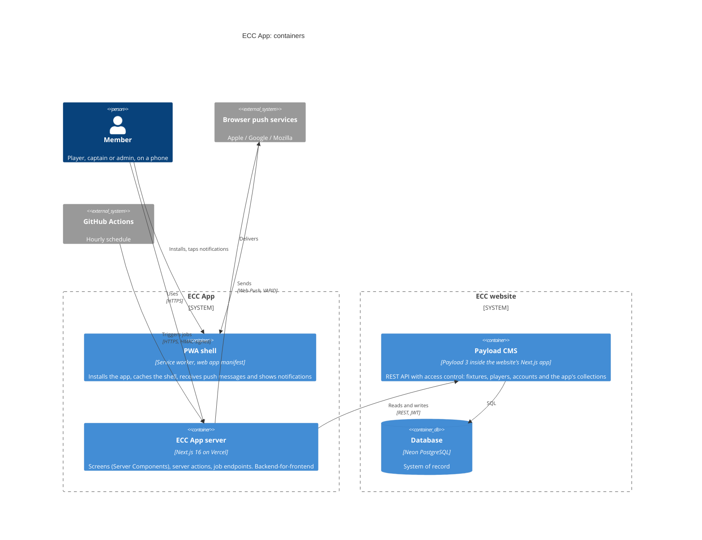
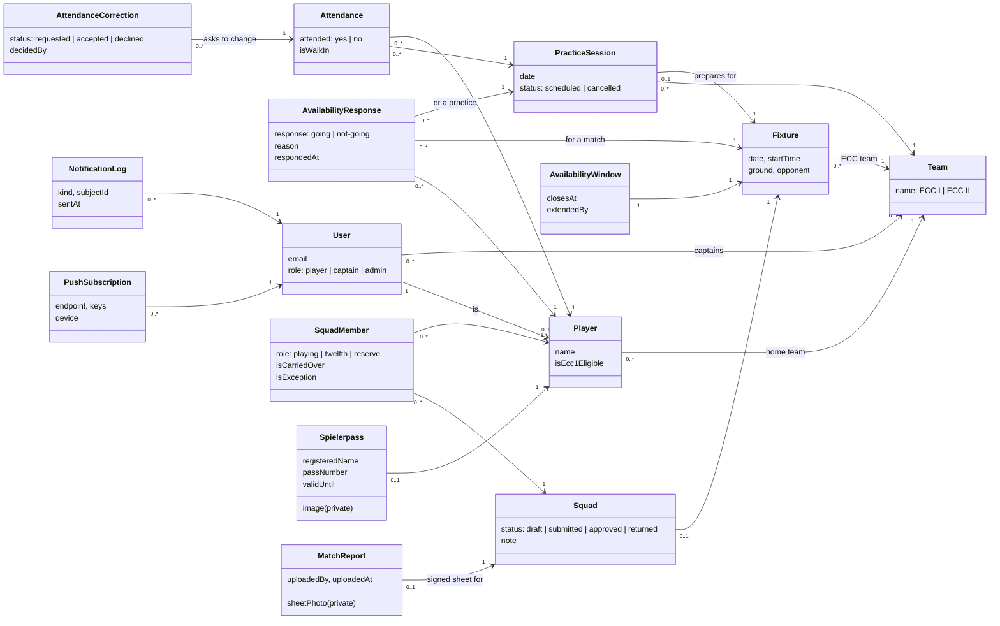

# 5. Building Block View

## 5.1 Level 1: containers

## 5.2 Level 2: feature slices of the ECC App server

| Building block            | Responsibility                                                                                                                                                                                                                                                                                                                                                                                                                                                                                                                                                                                                                                                                  |
| ------------------------- | ------------------------------------------------------------------------------------------------------------------------------------------------------------------------------------------------------------------------------------------------------------------------------------------------------------------------------------------------------------------------------------------------------------------------------------------------------------------------------------------------------------------------------------------------------------------------------------------------------------------------------------------------------------------------------- |
| `features/auth`           | Sign-in against Payload, session cookie, current member and role, route guards.                                                                                                                                                                                                                                                                                                                                                                                                                                                                                                                                                                                                 |
| `features/week`           | The player's week (UC-1, UC-2, UC-3, UC-7): `build-week` turns events, answers and practices into the week with deadlines, open answers and the attendance standing (pure, tested); the screen's components. Reads sample data until the backend is connected (`server/sample-week.ts`, same shape).                                                                                                                                                                                                                                                                                                                                                                            |
| `features/availability`   | Going / Not going with reason; change until the deadline; captain and admin views of who answered what.                                                                                                                                                                                                                                                                                                                                                                                                                                                                                                                                                                         |
| `features/attendance`     | The member's season as a ledger (UC-7, UC-20): the attendance standing for the next match, the availability targets (counted from the Board's start date) and every practice by month; a missed practice can be corrected on request (UC-18), which the team's captain or an admin accepts or declines on the Team screen.                                                                                                                                                                                                                                                                                                                                                      |
| `features/team`           | The captain's tools for the team they lead, and for an admin standing in for any team (a team switcher): the week's practices and matches, the practice check-in (UC-6, walk-ins and corrections included) and squad selection (UC-9) from the players who said Going, with eligibility and carry-overs marked, nothing preselected, and the 12th man asked for once the XI is full; submission to the Board, after which only the Board can reopen it. One slice, not the planned `practice` and `selection`, because both share the captain's access check and the team's data. Admin approval, selection notices and the player's attendance history come with later slices. |
| `features/spielerpass`    | Spielerpasses (image, name as registered, Pass Nr.); the match day pack and the filled DCB match report sheet for an approved squad (ADR-0007); upload of the signed sheet after the match.                                                                                                                                                                                                                                                                                                                                                                                                                                                                                     |
| `features/notifications`  | Push subscriptions per device, sending, the scheduled jobs and their send log.                                                                                                                                                                                                                                                                                                                                                                                                                                                                                                                                                                                                  |
| `features/board`          | The Board's screens (admins only): the week's squads, most urgent first; per match the captain's squad to approve and announce or send back with a note (UC-11), the answer deadline (UC-10) and exceptions for blocked players (UC-14). The Board never edits picks. Member management stays in the website's admin panel.                                                                                                                                                                                                                                                                                                                                                     |
| `domain/club-rules`       | Pure rules: practice day for a fixture, attendance window and countdown, deadlines, eligibility. No framework imports.                                                                                                                                                                                                                                                                                                                                                                                                                                                                                                                                                          |
| `shared/backend`          | Typed, `server-only` client for the Payload REST API; responses validated with Zod.                                                                                                                                                                                                                                                                                                                                                                                                                                                                                                                                                                                             |
| `shared/ui`, `shared/lib` | Design system; dates in Europe/Berlin; formatting.                                                                                                                                                                                                                                                                                                                                                                                                                                                                                                                                                                                                                              |

## 5.3 Domain model

Collections marked _(website)_ already exist in the website's Payload; the others are added there for the app (ADR-0002).

Derived, never stored: a player's attendance status (from `Attendance` over their team's last 4 practices), eligibility (attendance rule, ECC I flag, exceptions) and the countdown message.
