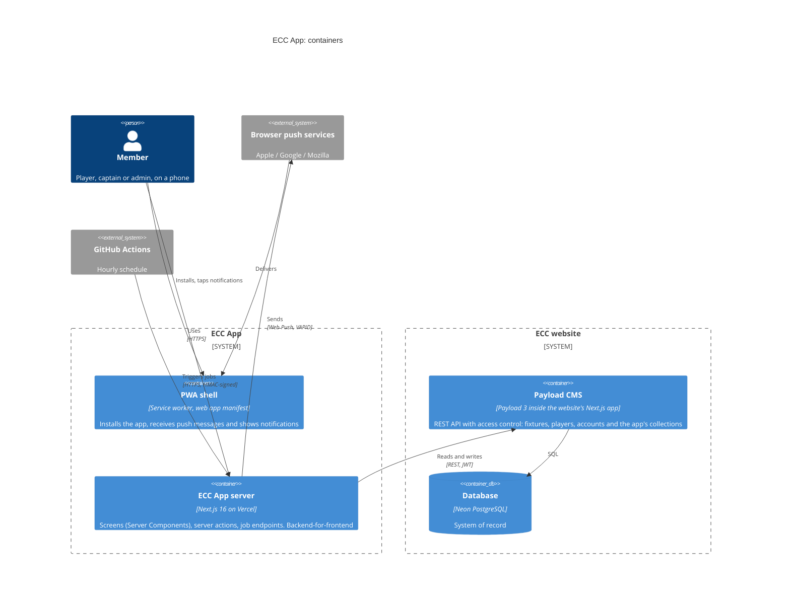
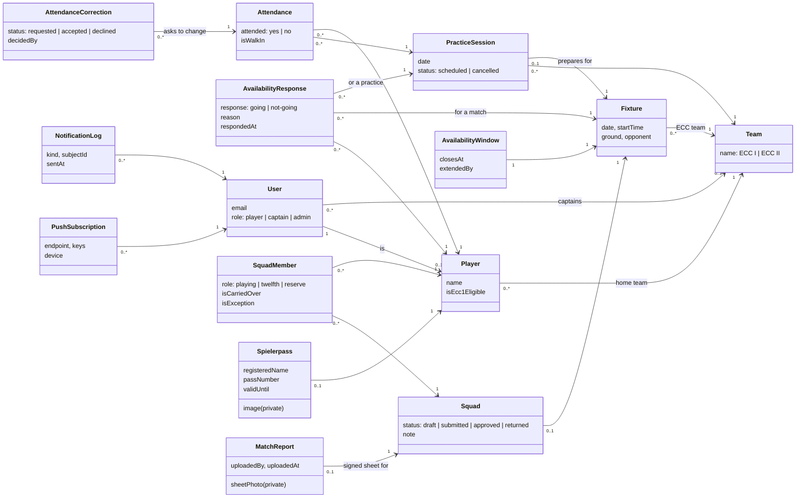

# 5. Building Block View

## 5.1 Level 1: containers

## 5.2 Level 2: feature slices of the ECC App server

| Building block            | Responsibility                                                                                                                                                                                                                                                                                                                                                                                                                                                                                                                                                                                                                                                                                                                                                                                            |
| ------------------------- | --------------------------------------------------------------------------------------------------------------------------------------------------------------------------------------------------------------------------------------------------------------------------------------------------------------------------------------------------------------------------------------------------------------------------------------------------------------------------------------------------------------------------------------------------------------------------------------------------------------------------------------------------------------------------------------------------------------------------------------------------------------------------------------------------------- |
| `features/auth`           | Sign-in against Payload, session cookie, current member and role, route guards.                                                                                                                                                                                                                                                                                                                                                                                                                                                                                                                                                                                                                                                                                                                           |
| `features/week`           | The player's week (UC-1, UC-2, UC-3, UC-7): `build-week` turns events, answers and practices into the week with deadlines, open answers and the attendance standing (pure, tested); the screen's components. Reads sample data until the backend is connected (`server/sample-week.ts`, same shape).                                                                                                                                                                                                                                                                                                                                                                                                                                                                                                      |
| `features/availability`   | Going / Not going with reason; change until the deadline; captain and admin views of who answered what.                                                                                                                                                                                                                                                                                                                                                                                                                                                                                                                                                                                                                                                                                                   |
| `features/attendance`     | The member's season as a ledger (UC-7, UC-20): the attendance standing for the next match, the availability targets (counted from the Board's start date) and every practice by month; a missed practice can be corrected on request (UC-18), which the team's captain or an admin accepts or declines on the Team screen.                                                                                                                                                                                                                                                                                                                                                                                                                                                                                |
| `features/profile`        | The member's profile: name, team, role and linked player; the language (English or German); notifications on this device (a slot the route fills from `features/notifications`, so profile does not depend on it); signing out, which first ends this device's push subscription.                                                                                                                                                                                                                                                                                                                                                                                                                                                                                                                         |
| `features/team`           | The captain's tools for the team they lead, and for an admin standing in for any team (a team switcher): the week's practices and matches, the practice check-in (UC-6, walk-ins and corrections included) and squad selection (UC-9) from the players who said Going, with eligibility and carry-overs marked, nothing preselected, and the 12th man asked for once the XI is full; submission to the Board, after which only the Board can reopen it. One slice, not the planned `practice` and `selection`, because both share the captain's access check and the team's data. It also lists last week's announced matches, so match day stays reachable while the signed sheet is still due (the Tuesday after, § 25 DCB-SPO) and no-shows are unrecorded. Selection notices come with a later slice. |
| `features/match-day`      | An approved squad's match day for its captain or an admin (UC-13, UC-21, UC-22): the official DCB match report sheet filled with ECC's block as a PDF (ADR-0007), every selected player's Spielerpass with its card image, missing passes flagged, the signed sheet's photo uploaded after the match, and who did not appear (UC-19), which blocks them for the team's next match (R-14). Files are served by `app/api/match-day/*` routes that check access on every request.                                                                                                                                                                                                                                                                                                                            |
| `features/season`         | The whole season for every member (UC-23), the Week tab's second view (This week / Season): every ECC match of the calendar year as a timeline of months and match days, both teams on a day, the member's own team first (R-7), a T20 double-header folded into one fixture with both results. `build-season` is pure and fully tested. Results are not computed here: the website derives them from the scorecard and serves them as the fixture's read-only `matchResult` field (website ADR-0026), so website and app always state the same result. The played part starts folded, so the screen opens on the next match day by layout alone: no scrolling after hydration that would move the page under the thumb.                                                                                  |
| `features/notifications`  | Web Push (ADR-0003): the setting on the Profile screen (every device state: checking, unsupported, iPhone not yet on the Home Screen, blocked, off, on, and a test notification); devices registered in the website's `push-subscriptions` by the app's service account after the member's session is checked, so a shared phone follows whoever is signed in; sending with `web-push`, removing subscriptions the push service reports gone (404/410). `public/sw.js` shows notifications and opens the screen they point to. What is sent, and when, is `features/jobs`' concern.                                                                                                                                                                                                                       |
| `features/jobs`           | The hourly tick (ADR-0004): `app/api/jobs/tick` checks the scheduler's signature, loads the club's week as the service account (creating missing practices, UC-5), and pure planners decide what is due: the daily 11:00 reminder (UC-4, R-10), the check-in prompt from 21:00 on practice day (UC-6), the prompt to pick the squad (UC-9), each squad step to the Board, the captain or the players who said Going (UC-11, UC-12), and attendance warnings once a practice is recorded (UC-8). Each is claimed in `notification-log` under a deterministic key before it is sent. `sendDueNotificationsSoon` runs the tick right after a squad is submitted, a practice recorded or a Board decision made.                                                                                               |
| `features/board`          | The Board's screens (admins only): the week's squads, most urgent first; per match the captain's squad to approve and announce or send back with a note (UC-11), the answer deadline (UC-10) and exceptions for blocked players (UC-14). The Board never edits picks. Member management stays in the website's admin panel.                                                                                                                                                                                                                                                                                                                                                                                                                                                                               |
| `domain/club-rules`       | Pure rules: practice day for a fixture, attendance window and countdown, deadlines, eligibility. No framework imports.                                                                                                                                                                                                                                                                                                                                                                                                                                                                                                                                                                                                                                                                                    |
| `shared/backend`          | Typed, `server-only` client for the Payload REST API; responses validated with Zod.                                                                                                                                                                                                                                                                                                                                                                                                                                                                                                                                                                                                                                                                                                                       |
| `shared/ui`, `shared/lib` | Design system; dates in Europe/Berlin; formatting.                                                                                                                                                                                                                                                                                                                                                                                                                                                                                                                                                                                                                                                                                                                                                        |

## 5.3 Domain model

Collections marked _(website)_ already exist in the website's Payload; the others are added there for the app (ADR-0002).

Derived, never stored: a player's attendance status (from `Attendance` over their team's last 4 practices), eligibility (attendance rule, ECC I flag, exceptions) and the countdown message.
