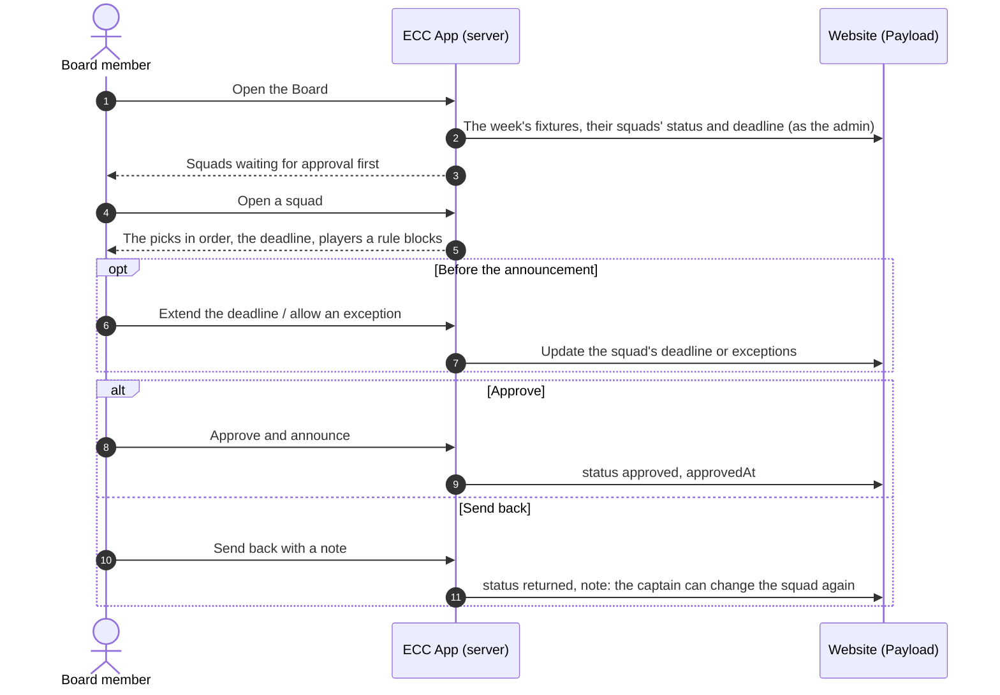

# 6. Runtime View

## 6.1 The club's week

```mermaid
sequenceDiagram
  autonumber
  participant GHA as GitHub Actions (hourly)
  participant App as ECC App server
  participant CMS as Payload CMS
  participant Push as Push services
  actor Player
  actor Captain
  actor Admin

  Note over GHA,App: Monday, first tick after 11:00 (Europe/Berlin); daily at 11:00 until answered
  GHA->>App: POST /api/jobs/tick (signed)
  App->>CMS: Fixtures of the week per team
  App->>App: club-rules: practice day per team (Sat → Wed, Sun → Thu)
  App->>CMS: Create practice sessions (idempotent)
  App->>Push: "This week: match Sat vs …, practice Wed. Are you in?"
  Push-->>Player: Notification
  Player->>App: Going / Not going (+ reason)
  App->>CMS: Save availability response

  Note over GHA,App: Practice day, first tick after 21:00
  GHA->>App: tick
  App->>Push: "Mark today's practice: 9 said going"
  Push-->>Captain: Notification
  Captain->>App: Attended / absent, add walk-ins
  App->>CMS: Save attendance
  App->>Push: Countdown to players who missed ("attend 2 of the next 3")

  Note over GHA,App: Availability closes (end of Tuesday, or as extended); the squad is picked after practice, announced by end of Thursday
  GHA->>App: tick
  App->>Push: "Pick your squad: 14 going, 12 eligible"
  Push-->>Captain: Notification
  Captain->>App: Select squad, submit
  App->>CMS: Save squad (submitted)
  App->>Push: "Squad for Saturday waiting for approval"
  Push-->>Admin: Notification
  Admin->>App: Approve
  App->>CMS: Squad approved
  App->>Push: "You are selected for Saturday" / "Not selected this time"
  Push-->>Player: Notification
```

Every scheduled step is idempotent: a step records what it did, so a second tick in the same hour, or a delayed tick, does nothing twice (ADR-0004).

## 6.2 Captain checks in a practice and selects the squad

The captain works as themselves: the website's access rules check every write is for their own team, and a guard lets a captain only submit a squad, never approve or change it after submitting: only the Board reopens it (ADR-0024 in the website).

```mermaid
sequenceDiagram
  autonumber
  actor C as Captain
  participant App as ECC App (server)
  participant CMS as Website (Payload)

  C->>App: Open the practice's check-in (on practice day)
  App->>CMS: Practice, its Going answers, attendance so far (as the captain)
  App-->>C: Squad list, Going players ticked
  C->>App: Save check-in (who came)
  App->>CMS: Create or flip attendance records, mark the practice recorded
  C->>App: Open the match's squad
  App->>CMS: Squad (created open by the service account if missing), last announced squad, answers, season attendance
  App-->>C: Going players with eligibility; nobody preselected
  C->>App: Tap 11 players, then the 12th man (asked for in a sheet), optional reserves
  C->>App: Submit for approval
  App->>App: Check the squad against the club rules (R-12) and each player's eligibility
  App->>CMS: Save the picks, status submitted: locked until the Board reopens it
```

## 6.3 The Board reviews a squad

The Board approves or sends back; it never changes the captain's picks. Each decision is checked against the squad's current status on the server, so two admins working at once cannot approve a squad that was just sent back.



## 6.4 Further scenarios

Added with their slices: first-run install guide; answering from a notification; selection notices after approval; captain records no-shows; captain opens Spielerpasses on match day.
