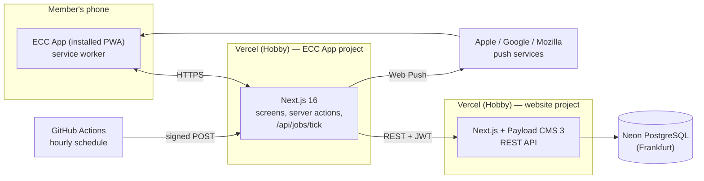

# 7. Deployment View

| Node             | Free tier used                        | Notes                                                       |
| ---------------- | ------------------------------------- | ----------------------------------------------------------- |
| Vercel (app)     | Hobby                                 | Region Frankfurt (`fra1`), next to Neon and the website.    |
| Vercel (website) | Hobby (existing)                      | Hosts Payload and its REST API.                             |
| Neon             | Free (existing)                       | Shared with the website; new tables via Payload migrations. |
| GitHub Actions   | Free for public repositories          | Hourly tick, CI.                                            |
| Push services    | Free, operated by the browser vendors | Encrypted payloads only.                                    |

Environment variables (validated with Zod in `shared/config/env.ts`): `BACKEND_URL` (the club website; empty = preview with sample data), `BACKEND_SERVICE_API_KEY` (the app's service account, an admin with an API key), `APP_NOW` (development only: pins the clock). Still to come with their features: `VAPID_PUBLIC_KEY`, `VAPID_PRIVATE_KEY`, `VAPID_SUBJECT`, `JOBS_SECRET`.
