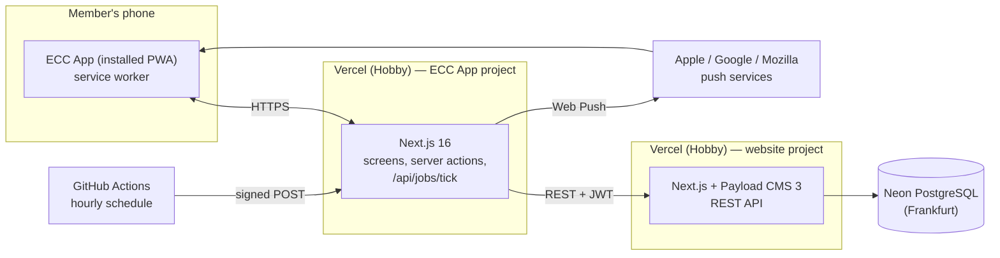

# 7. Deployment View

| Node             | Free tier used                        | Notes                                                       |
| ---------------- | ------------------------------------- | ----------------------------------------------------------- |
| Vercel (app)     | Hobby                                 | Region Frankfurt (`fra1`), next to Neon and the website.    |
| Vercel (website) | Hobby (existing)                      | Hosts Payload and its REST API.                             |
| Neon             | Free (existing)                       | Shared with the website; new tables via Payload migrations. |
| GitHub Actions   | Free for public repositories          | Hourly tick, CI.                                            |
| Push services    | Free, operated by the browser vendors | Encrypted payloads only.                                    |

The blank DCB match report sheet (`assets/dcb-match-report-sheet-2015.pdf`) is traced into the match-day routes (`outputFileTracingIncludes`). Server Actions accept bodies up to 4 MB (`serverActions.bodySizeLimit`) for the signed sheet's photo, which the browser scales down first; Vercel refuses request bodies over 4.5 MB.

Environment variables (validated with Zod in `shared/config/env.ts`): `BACKEND_URL` (the club website; empty = preview with sample data), `BACKEND_SERVICE_API_KEY` (the app's service account, an admin with an API key), `APP_NOW` (development only: pins the clock), `VAPID_PUBLIC_KEY`, `VAPID_PRIVATE_KEY` and `VAPID_SUBJECT` (Web Push, ADR-0003: all three or none; without them notifications are unavailable; the production key pair exists only in Vercel). Still to come with the scheduled jobs: `JOBS_SECRET`.
