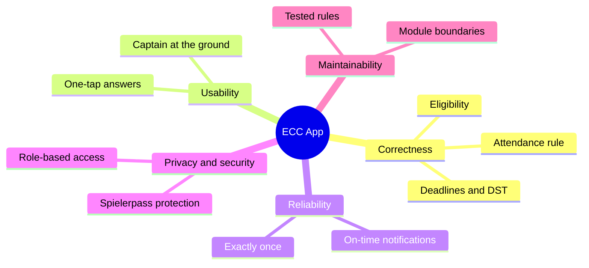

# 10. Quality Requirements

## 10.1 Quality tree

## 10.2 Quality scenarios

| ID    | Quality         | Scenario                                                                           | Measure                                                                 |
| ----- | --------------- | ---------------------------------------------------------------------------------- | ----------------------------------------------------------------------- |
| QS-1  | Correctness     | A player attended 1 of their team's last 4 practices. The captain opens selection. | The player is listed as not eligible, with "1 of 4 practices".          |
| QS-2  | Correctness     | A fixture is on the Sunday after the clock changes in October.                     | The practice is on the Thursday before; reminders arrive in local time. |
| QS-3  | Usability       | A player taps the Monday notification.                                             | They have answered within 2 taps and 10 seconds.                        |
| QS-4  | Usability       | A captain marks attendance for 14 players at the ground on a phone.                | Done in under 60 seconds, one hand.                                     |
| QS-5  | Reliability     | GitHub triggers the hourly job twice in the same hour.                             | No member receives a notification twice.                                |
| QS-6  | Reliability     | One hourly trigger is skipped.                                                     | The next trigger sends everything that became due.                      |
| QS-7  | Privacy         | A player opens another player's Spielerpass URL.                                   | Access denied; the attempt is logged.                                   |
| QS-8  | Privacy         | A captain of ECC II views ECC I's availability.                                    | Sees going / not going, but not ECC I players' reasons.                 |
| QS-9  | Maintainability | The club changes the rule to "3 of the last 5".                                    | One constant and its tests change; nothing else.                        |
| QS-10 | Performance     | A player opens the app on mobile data.                                             | The week is visible in under 2.5 s (LCP); cached week shown offline.    |
